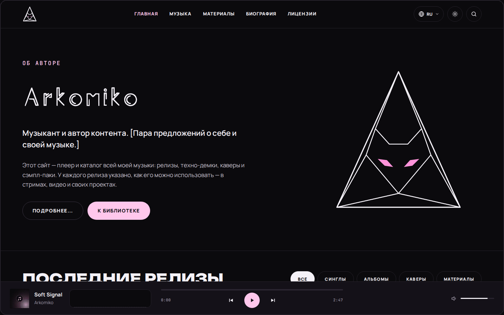

<picture>
  <source media="(prefers-color-scheme: dark)" srcset="../GiDo/RU-ru/assets/banner-dark.svg">
  <source media="(prefers-color-scheme: light)" srcset="../GiDo/RU-ru/assets/banner-light.svg">
  
</picture>

**Шаблон сайта-плеера для музыканта** · **Music player website template**

### [Русский](../GiDo/RU-ru/README.md) · [English](../GiDo/EN-us/README.md)

<picture>
  <source media="(prefers-color-scheme: dark)" srcset="../GiDo/RU-ru/assets/screens/home-dark.png">
  <source media="(prefers-color-scheme: light)" srcset="../GiDo/RU-ru/assets/screens/home-light.png">
  
</picture>

Статический сайт на Astro с плеером на Vue: релизы, демки, сэмпл-паки, лицензии, языки, тёмная и светлая тема. В репозитории только основа, без музыки и личных данных автора. Вся документация — в папке [`GiDo/`](../GiDo), по папке на язык.

A static Astro site with a Vue player: releases, demos, sample packs, licenses, languages, dark and light themes. The repository holds only the base — no music or personal data of the author. All documentation is in [`GiDo/`](../GiDo), one folder per language.

Код — [Arkomiko.Music Code License 1.0](../LICENSE) · Code — [Arkomiko.Music Code License 1.0](../LICENSE)
