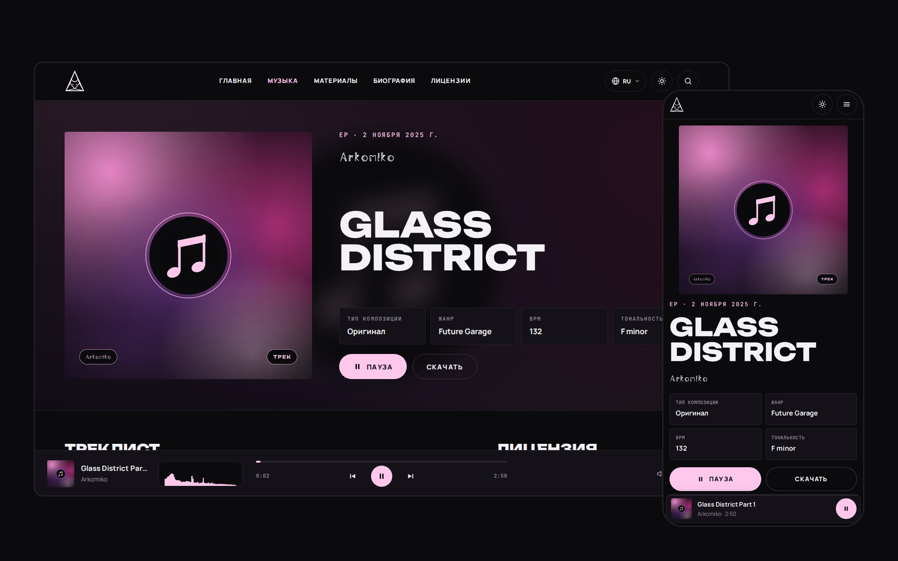
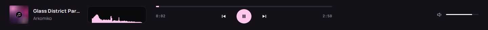
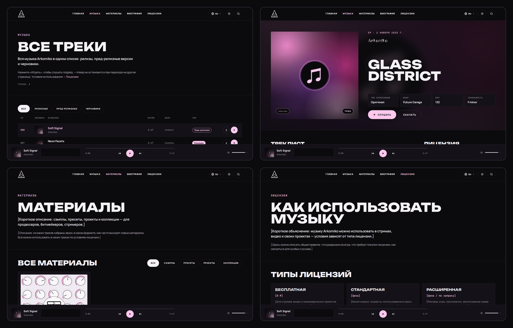
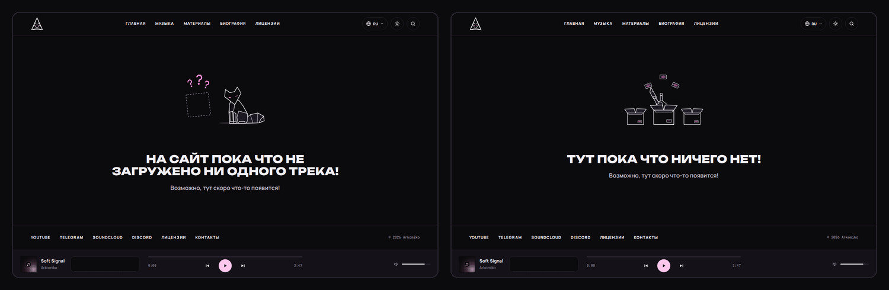
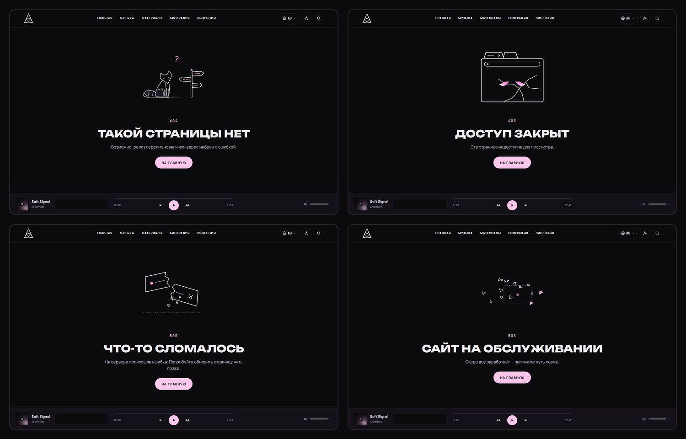

# Дизайн

[← К README](README.md)

Визуальная система сайта Arkomiko.Music. Логотип, маскот, иллюстрации и палитра принадлежат автору и не входят в лицензию кода, см. [USAGE.md](USAGE.md) и [LICENSES.md](LICENSES.md).

Скриншоты сделаны на демонстрационном контенте: шаблонные обложки и тестовые звуковые файлы.

## Содержание

- [Принципы](#принципы)
- [Десктоп и телефон](#десктоп-и-телефон)
- [Цвет](#цвет)
- [Типографика](#типографика)
- [Сетка и размеры](#сетка-и-размеры)
- [Плеер](#плеер)
- [Страницы](#страницы)
- [Пустые состояния](#пустые-состояния)
- [Страницы ошибок](#страницы-ошибок)
- [Логотип и иконка вкладки](#логотип-и-иконка-вкладки)
- [Графика репозитория](#графика-репозитория)

## Принципы

- Минимализм между Apple и WinUI (Metro): крупная типографика, плоские поверхности, тонкие линии, без декоративных теней и градиентов.
- Один акцентный цвет. Розовый используется для действий, активных состояний и глаз маскота.
- Две равноправные темы. Пока посетитель не выбрал тему сам, она как в системе и меняется вслед за ней; выбор сохраняется в браузере. Смена темы плавная: новая тема раскрывается кругом от кнопки.
- Письмо справа налево (арабский, персидский, урду): раскладка отражается, но кнопки и шкала плеера остаются слева направо, а разрядка букв отключается — она рвёт арабскую вязь.
- Анимация — только там, где она что-то сообщает: спектрометр плеера и иллюстрации пустых состояний и ошибок. При системной настройке «уменьшить движение» анимации отключаются.

## Десктоп и телефон

<picture>
  <source media="(prefers-color-scheme: dark)" srcset="assets/screens/desktop-mobile-dark.png">
  <source media="(prefers-color-scheme: light)" srcset="assets/screens/desktop-mobile-light.png">
  
</picture>

На телефоне меню сворачивается в кнопку, нижний плеер становится компактным, спектрометр переносится в полноэкранный плеер.

## Цвет

Токены задаются в `src/styles/global.css`. Изменение токена меняет весь сайт.

| Токен          | Тёмная тема | Светлая тема | Назначение                 |
| -------------- | ----------- | ------------ | -------------------------- |
| `--bg`         | `#0b0a0d`   | `#faf7fa`    | фон страницы               |
| `--surface`    | `#141118`   | `#ffffff`    | карточки, плеер            |
| `--surface-2`  | `#1c1822`   | `#efe9f1`    | вложенные поверхности      |
| `--line`       | `#26222b`   | `#e4dde7`    | разделители и рамки        |
| `--line-2`     | `#3a3442`   | `#cfc6d3`    | рамки кнопок               |
| `--text`       | `#f4f1f7`   | `#151217`    | основной текст             |
| `--soft`       | `#c9c3d1`   | `#3c3642`    | второстепенный текст       |
| `--muted`      | `#9a94a3`   | `#6b6472`    | подписи и метаданные       |
| `--accent`     | `#ffc7ec`   | `#ffc7ec`    | заливка кнопок и плашек    |
| `--accent-ink` | `#ffc7ec`   | `#b3307c`    | акцентный текст и ссылки   |
| `--on-accent`  | `#151217`   | `#151217`    | текст на акцентной заливке |
| `--logo-eye`   | `#ff93da`   | `#b3307c`    | глаза логотипа и маскота   |

## Типографика

| Роль      | Шрифт          | Где используется                          |
| --------- | -------------- | ----------------------------------------- |
| Ник       | Halfomania     | только слово «Arkomiko»                   |
| Заголовки | Unbounded      | заголовки страниц и разделов, пункты меню |
| Текст     | Manrope        | основной текст, названия треков, кнопки   |
| Данные    | JetBrains Mono | время, номера треков, метки, copyright    |

Unbounded, Manrope и JetBrains Mono подключаются через Fontsource. Halfomania лежит в `src/assets/fonts/` и подключается через `@font-face` в `global.css`.

## Сетка и размеры

| Токен            | Значение                                    |
| ---------------- | ------------------------------------------- |
| `--container`    | 1440px — максимальная ширина контента       |
| `--pad`          | 64px десктоп, 32px до 1199px, 14px до 767px |
| `--header-h`     | 80px, на телефоне 56px                      |
| `--player-space` | 96px, на телефоне 70px — место под плеер    |
| `--radius`       | 4px — радиус плашек и полей                 |

## Плеер

<picture>
  <source media="(prefers-color-scheme: dark)" srcset="assets/screens/player-dark.png">
  <source media="(prefers-color-scheme: light)" srcset="assets/screens/player-light.png">
  
</picture>

- Плеер закреплён внизу экрана и не останавливается при переходе между страницами и смене языка.
- Между названием трека и шкалой времени находится спектрометр в закруглённой рамке. Анализ спектра — Web Audio API, 84 полосы по логарифмической шкале от 30 Гц до 16 кГц; столбики растут от нижней кромки рамки.
- Кнопки и шкала времени остаются точно по центру независимо от длины названия.
- Очередь, перемешивание и повтор хранятся в `src/stores/player.ts`.

## Страницы

<picture>
  <source media="(prefers-color-scheme: dark)" srcset="assets/screens/pages-dark.png">
  <source media="(prefers-color-scheme: light)" srcset="assets/screens/pages-light.png">
  
</picture>

| Пункт меню | Адрес              | Содержимое                                               |
| ---------- | ------------------ | -------------------------------------------------------- |
| Главная    | `/`                | об авторе, последние релизы с фильтрами, последние треки |
| Музыка     | `/music`           | все треки с фильтром по статусу                          |
| —          | `/release/<папка>` | страница трека или релиза                                |
| Материалы  | `/materials`       | сэмплы, пресеты, проекты, коллекции                      |
| Биография  | `/about`           | биография, занятия, опыт, контакты                       |
| Лицензии   | `/licenses`        | типы лицензий, разрешения, указание автора               |

## Пустые состояния

Если контента нет, вместо раздела показывается служебная страница с анимированной иллюстрацией. Иллюстрации есть в двух вариантах — для тёмной и светлой темы.

<picture>
  <source media="(prefers-color-scheme: dark)" srcset="assets/screens/empty-dark.png">
  <source media="(prefers-color-scheme: light)" srcset="assets/screens/empty-light.png">
  
</picture>

| Страница            | Когда показывается                              | Где                                |
| ------------------- | ----------------------------------------------- | ---------------------------------- |
| `/non_content_user` | в `contents_user/` нет ни треков, ни материалов | главная, «Музыка», «Материалы»     |
| `/non_traks`        | нет треков                                      | «Музыка» и блок «Треки» на главной |
| `/non_pack`         | нет материалов                                  | «Материалы»                        |

Адреса `/non_…` открываются напрямую для проверки и закрыты от индексации.

## Страницы ошибок

<picture>
  <source media="(prefers-color-scheme: dark)" srcset="assets/screens/errors-dark.png">
  <source media="(prefers-color-scheme: light)" srcset="assets/screens/errors-light.png">
  
</picture>

| Адрес                | Ошибка               | Иллюстрация                                    |
| -------------------- | -------------------- | ---------------------------------------------- |
| любой несуществующий | 404 — страницы нет   | `address-error-07`, видео WEBM с прозрачностью |
| `/403`               | доступ закрыт        | `page-error-03`, статичная                     |
| `/500`               | внутренняя ошибка    | `page-error-02`, анимированная                 |
| `/503`               | сайт на обслуживании | `page-error-07`, анимированная                 |

В Safari и при включённом «уменьшить движение» видео 404 заменяется анимированной SVG того же рисунка: Safari не поддерживает прозрачность в WEBM.

## Логотип и иконка вкладки

- Логотип «лиса в A» собран из семи граней в `src/components/ui/Logo.astro`. Контур рисуется цветом текста, глаза — токеном `--logo-eye`.
- На главной логотип вращается (`variant="rotate"`): 96 кадров из `src/assets/logo/logo-rotate.svg`, бесшовный цикл 5 секунд. Цвета берутся из темы. Кадры подгружаются после загрузки страницы и только на экранах, где логотип виден; при «уменьшении движения» логотип неподвижен.
- Переключатель языка — круглый флаг текущего языка; в списке у каждого языка свой флаг (`src/assets/flags/`).
- Вариант `mark` — для шапки, толстые линии и залитые грани. Вариант `line` — крупный, тонкие линии.
- Иконка вкладки меняется вместе с темой: `public/favicon-dark.ico` и `public/favicon-light.ico`.

## Графика репозитория

| Файл                                    | Назначение                                                   |
| --------------------------------------- | ------------------------------------------------------------ |
| `assets/banner-dark.svg`, `-light.svg`  | анимированный баннер README для тёмной и светлой темы GitHub |
| `assets/divider-dark.svg`, `-light.svg` | пунктирный разделитель разделов                              |
| `assets/social-preview.png`             | превью ссылки на репозиторий, 1280×640                       |
| `assets/screens/`                       | скриншоты для документации                                   |

Текст в баннере переведён в контуры: GitHub показывает SVG как изображение и не загружает в нём внешние шрифты. Анимация баннера выполняется один раз при загрузке, спектр продолжает пульсировать. При «уменьшить движение» баннер показывается сразу в конечном виде.
