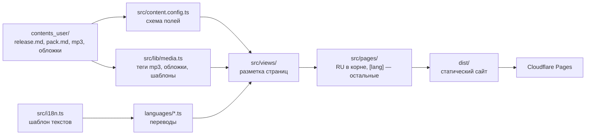

# Разработка

[← К README](README.md)

## Содержание

- [Требования](#требования)
- [Запуск в VS Code](#запуск-в-vs-code)
- [Запуск из терминала](#запуск-из-терминала)
- [Как устроена сборка](#как-устроена-сборка)
- [Что где лежит](#что-где-лежит)
- [Как устроен компонент](#как-устроен-компонент)
- [Языки и тема](#языки-и-тема)
- [Скорость и слабый интернет](#скорость-и-слабый-интернет)
- [Публикация](#публикация)
- [Проверки в GitHub Actions](#проверки-в-github-actions)
- [Выпуск версии](#выпуск-версии)

## Требования

- Node.js 22 или новее (поле `engines` в `package.json`).
- npm.

## Запуск в VS Code

1. Открой папку проекта.
2. Согласись установить рекомендованные расширения: Astro, Vue, Prettier, YAML.
3. Нажми F5 — конфигурация «Сайт: dev-сервер» запустит сервер и откроет браузер. Если `node_modules` нет, `npm install` выполнится сам.

Другие конфигурации в панели «Запуск и отладка»:

| Конфигурация                      | Что делает                                   |
| --------------------------------- | -------------------------------------------- |
| Сайт: dev-сервер в сети (телефон) | сервер доступен устройствам в локальной сети |
| Сайт: собрать и посмотреть        | `npm run build`, затем `npm run preview`     |
| Проверка: astro check             | проверка типов и шаблонов                    |

Форматирование при сохранении настроено в `.vscode/settings.json`.

## Запуск из терминала

```bash
npm install        # один раз
npm run dev        # http://localhost:4321, обновляется при сохранении
npm run build      # готовый сайт в dist/
npm run preview    # просмотр собранного dist/
npm run check      # astro check
npm run format     # prettier --write .
```

## Как устроена сборка



Сайт полностью статический: при сборке Astro читает контент, теги mp3 и обложки, и генерирует HTML для каждого адреса на каждом языке из `languages/`. На клиенте работают только Vue-компоненты плеера, таблиц треков и кнопок воспроизведения.

## Что где лежит

```
src/
├── pages/                 адреса сайта: русский в корне, [lang]/ — остальные языки; тонкие обёртки над views
├── views/                 страницы целиком, по папке на страницу
│   ├── home/              главная
│   ├── music/             все треки
│   ├── release/           страница релиза
│   ├── materials/         сэмплы, пресеты, проекты
│   ├── about/             биография
│   ├── licenses/          лицензии; licenses.data.ts — таблицы «что можно»
│   └── system/            пустые состояния и страницы ошибок
├── components/            части страниц
│   ├── layout/            шапка, подвал, список языков
│   ├── player/            плеер, спектрометр, кнопки «Играть», треклист, таблица треков
│   ├── catalog/           сетка «Последние релизы»
│   ├── system/            пустое состояние, иллюстрации ошибок
│   └── ui/                иконки, логотип, флаги
├── layouts/Base.astro     каркас страницы; head/ — скрипты темы и языка, которые работают до отрисовки
├── lib/                   логика без разметки: контент, языки, тема, флаги, спектр, иконки
├── stores/player.ts       состояние плеера: очередь, перемешивание, повтор
├── styles/                общие стили: токены, база, типографика, кнопки, письмо справа налево, смена темы
├── assets/                шрифт ника, шаблонные обложки, иллюстрации, логотип, флаги
├── i18n.ts                шаблон текстов интерфейса
├── site.config.ts         значения шаблона; личное — contents_user/profile/site.json
└── content.config.ts      поля release.md и pack.md
```

### Как устроен компонент

У каждого компонента и страницы рядом лежат файлы с тем же именем:

| Файл                   | Что в нём                                                                |
| ---------------------- | ------------------------------------------------------------------------ |
| `Имя.astro`, `Имя.vue` | разметка                                                                 |
| `Имя.css`              | стили — исходный вид, письмо слева направо                               |
| `Имя.rtl.css`          | правки для письма справа налево (арабский, персидский, урду), если нужны |
| `Имя.client.ts`        | поведение в браузере: фильтры, всплывающие окна, кнопки                  |

Стили подключаются в компоненте и остаются изолированными — классы из разных файлов не мешают друг другу:

- в `.astro`: `<style>@import './Имя.css'; @import './Имя.rtl.css';</style>`; правило для письма справа налево пишется так: `:global([dir='rtl']) .класс { … }`;
- в `.vue`: `<style scoped src="./Имя.css"></style>`; правило — `[dir='rtl'] .класс { … }`.

Направления в стилях — логические: `text-align: start`, `padding-inline-start`, `inset-inline-end`. Они сами разворачиваются при письме справа налево; в `Имя.rtl.css` остаётся только то, что разворачиваться не должно (кнопки и шкала плеера) или должно иначе (стрелки).

### Важные файлы

| Путь                                   | Назначение                                                                                          |
| -------------------------------------- | --------------------------------------------------------------------------------------------------- |
| `contents_user/`                       | весь контент, см. [CONTENT.md](CONTENT.md)                                                          |
| `languages/`                           | переводы: файл на язык; в репозитории — RU и EN, ещё 57 — по готовности, см. [README](LANGUAGES.md) |
| `src/i18n.ts`                          | шаблон языка: все элементы интерфейса с подсказками                                                 |
| `src/lib/media.ts`                     | чтение контента, обложек и тегов mp3 при сборке                                                     |
| `src/lib/lang.ts`, `src/lib/locale.ts` | языки, перевод с подсказкой шаблона, даты; адреса на другом языке                                   |
| `src/lib/theme.ts`                     | переключение темы с плавной анимацией                                                               |
| `src/layouts/head/theme.inline.js`     | тема до отрисовки: выбор посетителя, иначе как в системе, и вслед за системой                       |
| `src/layouts/head/language.inline.js`  | язык при первом визите: выбранный в переключателе, иначе язык браузера                              |
| `src/components/player/Player.vue`     | нижний плеер и полноэкранный мобильный плеер                                                        |
| `src/components/ui/Logo.client.ts`     | вращение логотипа на главной                                                                        |
| `src/styles/tokens.css`                | цвета обеих тем, шрифты, размеры, брейкпоинты                                                       |
| `public/`                              | иконки вкладки                                                                                      |
| `GiDo/`                                | документация репозитория и её графика                                                               |
| `.github/`                             | GitHub Actions, шаблоны issues и pull request, правила участия                                      |

## Скорость и слабый интернет

Сайт проверялся в Chromium с имитацией 3G (400 кбит/с, задержка 400 мс) и процессора слабого телефона (в 4 раза медленнее).

| Что сделано                                                                                                              | Зачем                                                                                                                                 |
| ------------------------------------------------------------------------------------------------------------------------ | ------------------------------------------------------------------------------------------------------------------------------------- |
| Вращающийся логотип: в HTML один кадр, остальные 96 — отдельный файл после загрузки страницы и только если логотип виден | главная легче на ~20 КБ, телефон кадры не скачивает вообще                                                                            |
| Кадры логотипа переключает таймер, за экраном и в фоновой вкладке он спит                                                | раньше 96 CSS-анимаций держали процессор занятым на 57–72% даже в покое, теперь 14–16% на слабом телефоне и ~3% на обычном компьютере |
| Флаги — отдельные файлы, грузятся при открытии списка языков                                                             | 59 флагов не раздувают каждую страницу                                                                                                |
| Vue-компоненты получают только строки текущего языка                                                                     | словари всех языков не попадают в JavaScript                                                                                          |
| Фон шапки релиза — обложка 96 px под размытием, сама обложка грузится первой                                             | главный элемент страницы релиза появляется на 3,8 с вместо 7,2 с                                                                      |
| Картинки сетки релизов под ширину экрана, таблица треков на главной оживает при появлении на экране                      | меньше байтов и работы до первого взгляда                                                                                             |

Повторить замер: собрать сайт (`npm run build`) и открыть `dist` через любой статический сервер с ограничением скорости, например вкладку Network → Throttling в DevTools.

## Публикация

### Личный профиль

Всё личное лежит в `contents_user/profile/` и в git не попадает:

| Файл                 | Что внутри                                                                                |
| -------------------- | ----------------------------------------------------------------------------------------- |
| `site.json`          | имя, домен (`url`), почта, почта по лицензиям, соцсети, карточки и годы «Биографии»       |
| `languages/RU-ru.ts` | тексты главной и «Биографии» — перекрывают `languages/RU-ru.ts`; так же для других языков |

Образец — `contents_user/profile/.template-content/`. В любом тексте можно писать `{name}`, `{domain}`, `{email}`, `{licenseEmail}` — подставятся из `site.json`.

### Deploy: архив для обычного хостинга

`npm run deploy` (в VS Code — «Deploy: архив для хостинга» в «Запуск и отладка») собирает сайт и кладёт архив в `deploy/<домен>.zip`. В сборку попадают контент без `draft: true`, профиль и только языки, опубликованные в git. Медиафайлы, на которые не ссылается ни одна страница (треки и обложки скрытых релизов), из сборки удаляются.

Выложить: панель хостинга → файловый менеджер → `public_html` → удалить старые файлы → загрузить архив → «Распаковать» → «Сюда». Для Apache в архиве уже есть `.htaccess`: страницы ошибок, кэш, переход на HTTPS (включается после выпуска сертификата — см. комментарий в файле).

### Отправка на GitHub

`npm run push -- "Что изменилось"` (в VS Code — «GitHub: залить изменения», текст спросит сам): форматирование, `astro check`, коммит и `git push`. Если в коммит попали профиль, треки или сборки, отправка отменяется.

### Cloudflare Pages

Вместо архива можно подключить Cloudflare Pages — сайт будет пересобираться при каждом push:

1. Подключи GitHub-репозиторий в Cloudflare Pages.
2. Команда сборки — `npm run build`, папка результата — `dist`.
3. Укажи переменную окружения `NODE_VERSION=22`.
4. Подключи свой домен.

Сайт пересобирается при каждом push в `main`. Страницу 404 хостинг отдаёт сам, страницы 403, 500 и 503 подключаются в настройках хостинга.

## Проверки в GitHub Actions

Workflow `.github/workflows/build.yml` запускается при push в `main` и в pull request'ах:

1. `npm ci`
2. `npm run check`
3. `npm run build`

Результат отображается бейджем «сборка» в README.

## Выпуск версии

Версии выпускаются по коду. Добавление треков и материалов версию не меняет.

Нумерация — [SemVer](https://semver.org/lang/ru/): `0.MINOR.PATCH` до первой стабильной версии.

| Изменение                                                                 | Что увеличивать               |
| ------------------------------------------------------------------------- | ----------------------------- |
| исправление ошибки                                                        | `PATCH`                       |
| новая возможность, новая страница                                         | `MINOR`                       |
| несовместимое изменение структуры `contents_user/` или полей `release.md` | `MINOR` до 1.0, затем `MAJOR` |

Порядок выпуска:

```bash
npm version patch -m "release: v%s"   # или minor; меняет package.json и создаёт тег
git push --follow-tags
```

Workflow `.github/workflows/release.yml` проверит, что версия тега совпадает с `package.json`, соберёт сайт и создаст релиз на GitHub с автоматическим списком изменений. Разделы списка задаются метками pull request'ов в `.github/release.yml`.
