<div align="center">

<picture>
  <source media="(prefers-color-scheme: dark)" srcset="Git-And-Docks/assets/banner-dark.svg">
  <source media="(prefers-color-scheme: light)" srcset="Git-And-Docks/assets/banner-light.svg">
  
</picture>

[](https://github.com/Arkomiko/Arkomiko.Music/actions/workflows/build.yml)
[](https://github.com/Arkomiko/Arkomiko.Music/releases)
[](LICENSE)
[](Git-And-Docks/RU-ru/LICENSES.md#бренд-и-оформление)
[](Git-And-Docks/RU-ru/LICENSES.md#музыка)
<br>
[](https://astro.build)
[](https://vuejs.org)
[](https://www.typescriptlang.org)
[](https://nodejs.org)

</div>

Сайт-плеер и каталог музыки Arkomiko: релизы, техно-демки, каверы, сэмпл-паки и лицензии. Статический сайт на Astro, плеер со спектрометром на Vue, русская и английская версии (готовятся ещё 57 языков), тёмная и светлая тема.

Репозиторий открыт для музыкантов-разработчиков: код можно изучать и собирать на его основе свою витрину.

> [!IMPORTANT]
> Это не шаблон для копирования 1 в 1 и не товар. Продавать код и делать на нём сайты на заказ нельзя; логотип, маскот, иллюстрации, музыка и имя Arkomiko в лицензию кода не входят. Перед публикацией своего сайта прочитай [инструкцию по использованию](Git-And-Docks/RU-ru/USAGE.md).

<picture>
  <source media="(prefers-color-scheme: dark)" srcset="Git-And-Docks/assets/screens/home-dark.png">
  <source media="(prefers-color-scheme: light)" srcset="Git-And-Docks/assets/screens/home-light.png">
  
</picture>

<sub>Скриншот сделан на демонстрационном контенте с шаблонными обложками.</sub>

<picture>
  <source media="(prefers-color-scheme: dark)" srcset="Git-And-Docks/assets/divider-dark.svg">
  <source media="(prefers-color-scheme: light)" srcset="Git-And-Docks/assets/divider-light.svg">
  
</picture>

## Содержание

- [Быстрый старт](#быстрый-старт)
- [Структура проекта](#структура-проекта)
- [Документация](#документация)
- [Использование и авторство](#использование-и-авторство)
- [Лицензии](#лицензии)
- [Версии](#версии)
- [Участие в проекте](#участие-в-проекте)
- [Связь](#связь)
- [Поддержать автора](#поддержать-автора)

## Быстрый старт

Нужен Node.js 22 или новее.

```bash
git clone https://github.com/Arkomiko/Arkomiko.Music.git
cd Arkomiko.Music
npm install
npm run dev        # http://localhost:4321
```

| Команда           | Что делает                                |
| ----------------- | ----------------------------------------- |
| `npm run dev`     | локальный сервер с перезагрузкой          |
| `npm run build`   | сборка готового сайта в `dist/`           |
| `npm run preview` | просмотр собранного `dist/`               |
| `npm run check`   | проверка типов и шаблонов (`astro check`) |
| `npm run format`  | форматирование Prettier                   |

В VS Code достаточно открыть папку и нажать F5: конфигурации запуска уже лежат в `.vscode/`. Подробнее в [DEVELOPMENT.md](Git-And-Docks/RU-ru/DEVELOPMENT.md).

## Структура проекта

<sub>Нажми на строку — папка раскроется. Имя папки или файла открывает его в репозитории.</sub>

<details open>
<summary><a href="https://github.com/Arkomiko/Arkomiko.Music"> <code>Arkomiko.Music</code></a> — корень репозитория</summary>
<blockquote>
  <details>
  <summary><a href="contents_user"> <code>contents_user/</code></a> — весь контент сайта, отдельно от кода</summary>
  <blockquote>
    <details>
    <summary><a href="contents_user/pack"> <code>pack/</code></a> — материалы, раздел «Материалы»</summary>
    <blockquote>
      <p>
      <a href="contents_user/pack/.template-content"> <code>.template-content/</code></a> — шаблоны паков всех типов; сайт их не читает<br>
      <a href="contents_user/pack/Semples"> <code>Semples/</code></a> — сэмплы и лупы<br>
      <a href="contents_user/pack/Presets"> <code>Presets/</code></a> — пресеты<br>
      <a href="contents_user/pack/Projects"> <code>Projects/</code></a> — проекты DAW<br>
      <a href="contents_user/pack/Collection"> <code>Collection/</code></a> — коллекции
      </p>
    </blockquote>
    </details>
    <details>
    <summary><a href="contents_user/licenses"> <code>licenses/</code></a> — полные тексты лицензий</summary>
    <blockquote>
      <p>
      <a href="contents_user/licenses/music.md"> <code>music.md</code></a> — релизы вне лейбла<br>
      <a href="contents_user/licenses/demo.md"> <code>demo.md</code></a> — техно-демки и черновики, CC BY-NC-SA 4.0<br>
      <a href="contents_user/licenses/free.md"> <code>free.md</code></a> — бесплатные материалы<br>
      <a href="contents_user/licenses/standard.md"> <code>standard.md</code></a> — материалы по подписке<br>
      <a href="contents_user/licenses/extended.md"> <code>extended.md</code></a> — материалы с синхронизацией
      </p>
    </blockquote>
    </details>
    <details>
    <summary><a href="contents_user/traks/.template-content"> <code>traks/</code></a> — треки: <code>RLS/</code> релизы, <code>DR/</code> черновики; в репозиторий попадают только шаблоны</summary>
    <blockquote>
      <p>
      <a href="contents_user/traks/.template-content"> <code>.template-content/</code></a> — шаблоны релизов: сингл, альбом, кавер, ремикс, лейбл, демо
      </p>
    </blockquote>
    </details>
    <p>
    <a href="contents_user/README.md"> <code>README.md</code></a> — как устроена папка
    </p>
  </blockquote>
  </details>
  <details>
  <summary><a href="src"> <code>src/</code></a> — код сайта: Astro и Vue</summary>
  <blockquote>
    <details>
    <summary><a href="src/views"> <code>views/</code></a> — страницы целиком: разметка, стили <code>.css</code>, поведение <code>.client.ts</code></summary>
    <blockquote>
      <p>
      <a href="src/views/home"> <code>home/</code></a> — главная: об авторе, последние релизы, треки<br>
      <a href="src/views/music"> <code>music/</code></a> — все треки с фильтром по статусу<br>
      <a href="src/views/release"> <code>release/</code></a> — страница релиза: треклист, площадки, лицензия, «О релизе»<br>
      <a href="src/views/materials"> <code>materials/</code></a> — сэмплы, пресеты, проекты, коллекции<br>
      <a href="src/views/about"> <code>about/</code></a> — биография<br>
      <a href="src/views/licenses"> <code>licenses/</code></a> — лицензии; <code>licenses.data.ts</code> — таблицы «что можно»<br>
      <a href="src/views/system"> <code>system/</code></a> — пустые состояния и ошибки 403, 404, 500, 503
      </p>
    </blockquote>
    </details>
    <details>
    <summary><a href="src/components"> <code>components/</code></a> — части страниц; рядом с каждым — <code>.css</code>, <code>.rtl.css</code>, <code>.client.ts</code></summary>
    <blockquote>
      <p>
      <a href="src/components/layout"> <code>layout/</code></a> — шапка (меню, язык с флагами, тема, поиск), подвал<br>
      <a href="src/components/player"> <code>player/</code></a> — плеер, спектрометр, кнопки «Играть», треклист, таблица треков<br>
      <a href="src/components/catalog"> <code>catalog/</code></a> — сетка «Последние релизы» с фильтрами<br>
      <a href="src/components/system"> <code>system/</code></a> — пустое состояние, иллюстрации ошибок<br>
      <a href="src/components/ui"> <code>ui/</code></a> — иконки, логотип (и вращение), флаги
      </p>
    </blockquote>
    </details>
    <details>
    <summary><a href="src/lib"> <code>lib/</code></a> — логика без разметки</summary>
    <blockquote>
      <p>
      <a href="src/lib/media.ts"> <code>media.ts</code></a> — читает contents_user: теги mp3, обложки, лицензии<br>
      <a href="src/lib/lang.ts"> <code>lang.ts</code></a> — языки из languages/, перевод с подсказкой шаблона, даты<br>
      <a href="src/lib/locale.ts"> <code>locale.ts</code></a> — основной язык и ссылки на другие языки<br>
      <a href="src/lib/theme.ts"> <code>theme.ts</code></a> — переключение темы с плавной анимацией<br>
      <a href="src/lib/flags.ts"> <code>flags.ts</code></a> — флаги языков<br>
      <a href="src/lib/spectrum.ts"> <code>spectrum.ts</code></a> — анализатор спектра на Web Audio<br>
      <a href="src/lib/icons.ts"> <code>icons.ts</code></a> — контуры иконок
      </p>
    </blockquote>
    </details>
    <details>
    <summary><a href="src/styles"> <code>styles/</code></a> — общие стили, подключает <code>global.css</code></summary>
    <blockquote>
      <p>
      <a href="src/styles/tokens.css"> <code>tokens.css</code></a> — цвета обеих тем, шрифты, размеры<br>
      <a href="src/styles/base.css"> <code>base.css</code></a> — сброс и база<br>
      <a href="src/styles/typography.css"> <code>typography.css</code></a> — заголовки и текст<br>
      <a href="src/styles/ui.css"> <code>ui.css</code></a> — кнопки, фильтры, плашки, карточки<br>
      <a href="src/styles/rtl.css"> <code>rtl.css</code></a> — письмо справа налево: общие правки<br>
      <a href="src/styles/theme-transition.css"> <code>theme-transition.css</code></a> — плавная смена темы
      </p>
    </blockquote>
    </details>
    <details>
    <summary><a href="src/assets"> <code>assets/</code></a> — шрифт, обложки, иллюстрации, логотип, флаги</summary>
    <blockquote>
      <p>
      <a href="src/assets/fonts"> <code>fonts/</code></a> — Halfomania и текст её лицензии<br>
      <a href="src/assets/flags"> <code>flags/</code></a> — круглые флаги языков (circle-flags, MIT)<br>
      <a href="src/assets/logo"> <code>logo/</code></a> — кадры вращения логотипа<br>
      <a href="src/assets/placeholders"> <code>placeholders/</code></a> — шаблонные обложки: Track, Draft, Samples<br>
      <a href="src/assets/system"> <code>system/</code></a> — маскот для пустых состояний и ошибок
      </p>
    </blockquote>
    </details>
    <p>
    <a href="src/pages"> <code>pages/</code></a> — адреса сайта: русский в корне, остальные языки — <code>[lang]/</code><br>
    <a href="src/layouts"> <code>layouts/</code></a> — <code>Base.astro</code> — каркас страницы; <code>head/</code> — тема и язык до отрисовки<br>
    <a href="src/stores/player.ts"> <code>stores/player.ts</code></a> — состояние плеера: очередь, shuffle, repeat<br>
    <a href="src/site.config.ts"> <code>site.config.ts</code></a> — имя, контакты, лицензии, подписи площадок<br>
    <a href="src/content.config.ts"> <code>content.config.ts</code></a> — поля <code>release.md</code> и <code>pack.md</code><br>
    <a href="src/i18n.ts"> <code>i18n.ts</code></a> — шаблон языка: все элементы интерфейса с подсказками
    </p>
  </blockquote>
  </details>
  <details>
  <summary><a href="Git-And-Docks"> <code>Git-And-Docks/</code></a> — документация репозитория</summary>
  <blockquote>
    <p>
    <a href="Git-And-Docks/RU-ru"> <code>RU-ru/</code></a> — документы на русском<br>
    <a href="Git-And-Docks/assets"> <code>assets/</code></a> — баннеры, скриншоты, значки
    </p>
  </blockquote>
  </details>
  <p>
  <a href="public"> <code>public/</code></a> — иконки вкладки для тёмной и светлой темы<br>
  <a href="languages"> <code>languages/</code></a> — переводы: по файлу на язык; в репозитории — русский и английский, остальные публикуются по готовности; <code>RU-ru.ts</code> — основной<br>
  <a href=".github"> <code>.github/</code></a> — сборка, выпуск версий, шаблоны issues, правила участия<br>
  <a href=".vscode"> <code>.vscode/</code></a> — запуск по F5 и настройки редактора<br>
  <a href="astro.config.mjs"> <code>astro.config.mjs</code></a> — настройки сборки<br>
  <a href="package.json"> <code>package.json</code></a> — зависимости, команды, версия<br>
  <a href="LICENSE"> <code>LICENSE</code></a> — лицензия кода<br>
  <a href="NOTICE.md"> <code>NOTICE.md</code></a> — авторство и материалы автора
  </p>
</blockquote>
</details>

Контент отделён от кода: чтобы добавить трек, достаточно создать папку в `contents_user/` и положить туда mp3 и `release.md`. Порядок действий описан в [CONTENT.md](Git-And-Docks/RU-ru/CONTENT.md).

## Документация

| Документ                                             | О чём                                                      |
| ---------------------------------------------------- | ---------------------------------------------------------- |
| [USAGE.md](Git-And-Docks/RU-ru/USAGE.md)             | правила использования шаблона и чек-лист замены бренда     |
| [CONTENT.md](Git-And-Docks/RU-ru/CONTENT.md)         | добавление треков, релизов и материалов, поля `release.md` |
| [DESIGN.md](Git-And-Docks/RU-ru/DESIGN.md)           | дизайн-система, скриншоты, плеер, пустые состояния, ошибки |
| [DEVELOPMENT.md](Git-And-Docks/RU-ru/DEVELOPMENT.md) | запуск, устройство кода, публикация, выпуск версий         |
| [LICENSES.md](Git-And-Docks/RU-ru/LICENSES.md)       | сравнение лицензий: код, бренд, музыка, зависимости        |
| [ROADMAP.md](Git-And-Docks/RU-ru/ROADMAP.md)         | планы развития                                             |
| [CONTRIBUTING.md](.github/CONTRIBUTING.md)           | как предложить изменения                                   |

Документация на других языках будет в соседних папках `Git-And-Docks/<язык>/`.

## Использование и авторство

Можно: изучать код, делать на его основе свой сайт со своей музыкой и текстами, продавать на нём свои произведения, менять что угодно в коде.

Обязательно:

- сохранять файлы `LICENSE` и `NOTICE.md` с указанием авторства Arkomiko во всех копиях кода;
- разместить в подвале каждой страницы подпись со ссылкой на репозиторий: «Работает на Astro и Vue. Создано на основе репозитория Arkomiko» или «Works on Astro and Vue. Built on the Arkomiko repo»;
- заменить все материалы автора на свои.

Нельзя: продавать код как шаблон, делать на нём сайты на заказ, использовать логотип, маскота, иллюстрации, музыку и имя Arkomiko, выдавать свой сайт за сайт Arkomiko.

Полные правила, готовый код подписи и список файлов, которые нужно заменить, — в [USAGE.md](Git-And-Docks/RU-ru/USAGE.md).

## Лицензии

| Что                                 | Лицензия                                                                     |
| ----------------------------------- | ---------------------------------------------------------------------------- |
| Код сайта                           | [Arkomiko.Music Code License 1.0](LICENSE)                                   |
| Имя, логотип, маскот, иллюстрации   | все права защищены, фан-творчество разрешено, см. [NOTICE](NOTICE.md)        |
| Шаблонные обложки                   | CC BY-NC 4.0                                                                 |
| Релизы вне лейблов                  | [Arkomiko Music License](contents_user/licenses/music.md)                    |
| Техно-демки и черновики             | [CC BY-NC-SA 4.0](contents_user/licenses/demo.md)                            |
| Релизы через лейбл                  | условия лейбла, указаны на странице релиза                                   |
| Сэмплы, пресеты, проекты, коллекции | Free, Standard, Extended — [contents_user/licenses](contents_user/licenses/) |
| Зависимости и шрифты                | лицензии их авторов                                                          |

Подробное сравнение — в [LICENSES.md](Git-And-Docks/RU-ru/LICENSES.md).

## Версии

Версии выпускаются по коду, а не по контенту: новый трек на сайте не меняет версию. Номер версии хранится в `package.json`, релизы с описанием изменений публикуются на странице [Releases](https://github.com/Arkomiko/Arkomiko.Music/releases) автоматически при создании тега `vX.Y.Z`. Порядок выпуска — в [DEVELOPMENT.md](Git-And-Docks/RU-ru/DEVELOPMENT.md#выпуск-версии).

## Участие в проекте

Pull request'ы принимаются выборочно: исправления ошибок и улучшения кода рассматриваются, изменения дизайна и бренда — нет. Перед крупным изменением открой issue. Правила — в [CONTRIBUTING.md](.github/CONTRIBUTING.md) и [CODE_OF_CONDUCT.md](.github/CODE_OF_CONDUCT.md).

<picture>
  <source media="(prefers-color-scheme: dark)" srcset="Git-And-Docks/assets/divider-dark.svg">
  <source media="(prefers-color-scheme: light)" srcset="Git-And-Docks/assets/divider-light.svg">
  
</picture>

## Связь

| Канал    | Адрес                                                      |
| -------- | ---------------------------------------------------------- |
| E-mail   | [Arikomika@gmail.com](mailto:Arikomika@gmail.com)          |
| Telegram | [t.me/arkomiko_gr](https://t.me/arkomiko_gr)               |
| YouTube  | [@arkomiko_music](https://www.youtube.com/@arkomiko_music) |

Вопросы по коду и ошибки — через [Issues](https://github.com/Arkomiko/Arkomiko.Music/issues).

## Поддержать автора

Arkomiko.Music делает один человек: музыкант, дизайнер и разработчик. Если шаблон пригодился, проект можно поддержать:

[](https://boosty.to/arkomiko)
[](https://www.patreon.com/cw/Arkomiko)
[](https://ko-fi.com/arkomiko)
[](https://www.donationalerts.com/r/arkomiko)

Поддержка идёт на развитие этого сайта и других проектов автора.

<div align="right"><sub>Всем уюта, чая и печенек.</sub></div>
